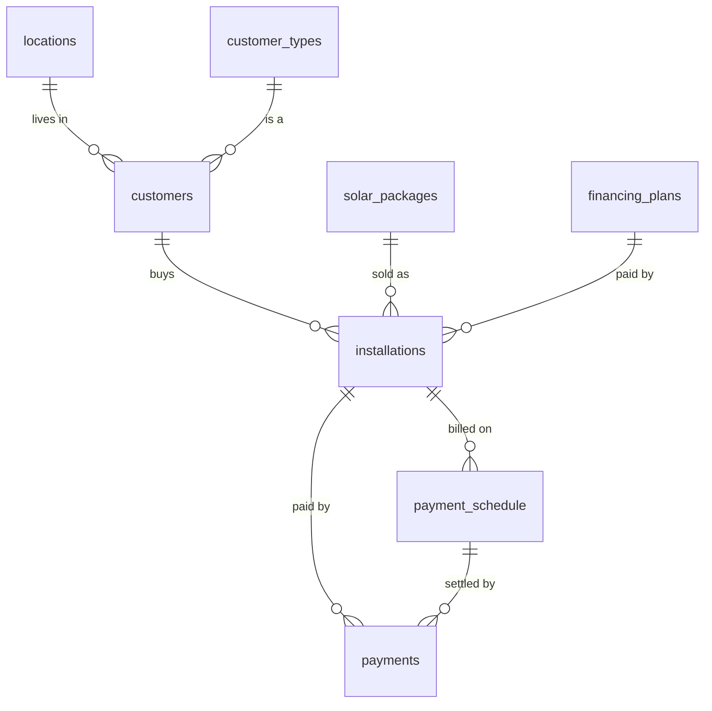

# Solar Installer SQL Case Study

**T-SQL (SQL Server) | Finance and operations analysis**

How fast is a solar installer growing, where is it installing, and how well is it getting paid?

> **Data disclosure:** "SunGrid Nigeria" is a fictional company and every record in this repository is **synthetic**. Naira prices and emission factors are illustrative, not real tariffs, and none of the figures are results from any real employer or client. The database was built for this case study so that the analysis could be done across many related tables.

---

## At a glance

| Metric | Value |
|---|---|
| Systems installed (Sep 2024 to Oct 2026) | 4,277 systems, 47,062 kW |
| Net sales (list price minus discounts) | ₦32.87bn |
| Collected so far | ₦28.25bn |
| Outstanding balance | ₦7.25bn |
| Overdue instalments | ₦742.9M across 1,448 instalments (10.3% of the outstanding balance) |
| Largest market | Lagos: 32.8% of systems |

---

## Scenario and scope

SunGrid Nigeria sells, finances and installs solar systems for homes and businesses across ten states. Its data sits in a SQL Server database of **16 related tables** (customers, leads, installations, solar packages, financing plans, payment schedules, payments, monthly generation, maintenance tickets and more). The full table list is in [`docs/data_dictionary.md`](docs/data_dictionary.md).

This case study answers **five business questions** about installation volume, geography, finance and collections. Each answer is a T-SQL query written in SQL Server Management Studio 21, with the result interpreted for the business.

| S/N | Business question | Query file |
|---|---|---|
| 1 | How many systems, and how much kW capacity, were installed per month and per week? | [`q1_monthly_weekly_installations.sql`](queries/q1_monthly_weekly_installations.sql) |
| 2 | Is installation volume growing? Month-over-month change, running total and moving average | [`q2_monthly_installation_trend.sql`](queries/q2_monthly_installation_trend.sql) |
| 3 | How are installations split by zone, state and system type? | [`q3_zone_state_installed_capacity.sql`](queries/q3_zone_state_installed_capacity.sql) |
| 4 | What are net sales, discounts, finance income, collections and outstanding balances by segment and financing plan? | [`q4_financials_by_segment_and_plans.sql`](queries/q4_financials_by_segment_and_plans.sql) |
| 5 | Which instalments are overdue (ageing), and how often do contracts end up fully paid? | [`q5_a_and_b.sql`](queries/q5_a_and_b.sql) |

## Database design

The five queries use eight of the sixteen tables:

## Definitions used

| Term | Definition |
|---|---|
| As-of date | 31 October 2026 |
| Installed system | An installation with status `Completed`. Scheduled and Cancelled installations are excluded |
| Capacity | `capacity_kw` of the installed package |
| Net price | `list_price - discount_amount` |
| Finance income | `finance_charge`, the flat charge on instalment plans |
| Collected | Sum of `payments.amount_paid` |
| Outstanding | `total_contract_value` minus collected, for completed installations. Includes instalments not yet due |
| Overdue instalment | A scheduled instalment with a due date before the as-of date and less paid against it than is due |
| Matured contract | A contract whose final instalment was due on or before the as-of date |
| Weeks | ISO weeks, labelled by their Monday |

---

## Q1. Installations per month and per week

**How the SQL works**
- Recursive CTEs build a month calendar and a week calendar, which are left-joined to the installations so that a period with no installs would still appear as zero.
- Weeks start on Monday using a date-difference calculation from 1 January 1900, which does not depend on the server's `DATEFIRST` setting. Each week carries its ISO week number and ISO year, so week 1 of 2025 correctly starts on 30 December 2024.
- `MAXRECURSION` is raised for the weekly calendar, which has 109 rows.
- The first month is flagged as a partial launch month.

**Result**
- 26 months and 109 weeks, totalling 4,277 systems and 47,062 kW.
- Operations began on 30 September 2024. October 2024 had 47 systems, and volume passed 200 a month in December 2025.
- The best month was June 2026, with 235 systems and 3,549 kW.
- Weekly volume averages 39 systems (median 40). The peak was 67 in the week of 30 March 2026, and the latest four weeks ran at 45 to 50.

---

## Q2. Is volume growing?

**How the SQL works**
- Window functions on top of the month calendar: `LAG` for month-over-month percentage change, a running `SUM` for cumulative capacity, and an `AVG` over a three-row `ROWS` frame for the moving average. The moving average stays NULL until three months exist.
- Division is protected with `NULLIF`.

**Result**
- Cumulative capacity reached 47,062 kW by October 2026.
- Monthly capacity climbed from 238 kW (October 2024) to a peak of 3,549 kW (June 2026), then fell to 1,866 kW in October 2026. The three-month moving average eased from 3,165 kW in August to 2,416 kW in October.
- Unit volume tells a steadier story: 10 of the last 11 months were between 215 and 235 systems (February 2026 was 175).

**What it means:** installation volume has plateaued at roughly 220 systems a month. The recent drop in kW comes from a smaller average system, 8.7 kW in October against 15.1 kW in June, not from fewer installs. Capacity is lumpy because a few large commercial projects swing the monthly total.

---

## Q3. Zone, state and system type

**How the SQL works**
- `GROUP BY GROUPING SETS` produces detail rows, state subtotals, zone subtotals, system-type totals and a grand total in a single query.
- The `GROUPING()` function labels each row type, and subtotal rows are labelled 'All zones', 'All states' and 'All system types' instead of showing NULL.
- Window functions (`SUM() OVER`) give each row its percentage of the grand total and its percentage within its parent. A `CASE` in the `ORDER BY` places subtotals directly after their detail rows.

**Result**

| Zone | Systems | Share | Capacity (kW) | Share |
|---|---|---|---|---|
| South West | 2,021 | 47.3% | 20,705 | 44.0% |
| South South | 711 | 16.6% | 8,244 | 17.5% |
| North Central | 640 | 15.0% | 7,293 | 15.5% |
| South East | 542 | 12.7% | 7,210 | 15.3% |
| North West | 363 | 8.5% | 3,610 | 7.7% |

| System type | Systems | Share | Capacity (kW) | Share |
|---|---|---|---|---|
| Hybrid | 3,662 | 85.6% | 30,173 | 64.1% |
| Grid-Tied | 506 | 11.8% | 16,780 | 35.7% |
| Off-Grid | 109 | 2.5% | 109 | 0.2% |

**What it means:** Lagos alone holds 32.8% of systems (1,401), followed by FCT (15.0%) and Rivers (10.1%). Kaduna is the smallest market at 3.3%. Hybrid systems are 85.6% of installs, but the 11.8% that are Grid-Tied supply 35.7% of capacity, which shows how much the large commercial projects matter to the kW total.

---

## Q4. Financials by segment and financing plan

**How the SQL works**
- Payments are pre-aggregated per installation in a CTE before being joined, so contract values are not multiplied by the number of payments. This is the most common source of wrong totals in finance queries.
- A left join keeps installations with no payments, and `COALESCE` turns their NULL totals into zero.

**Result by segment** (₦ billions)

| Segment | Installs | Net price | Discounts | Finance income | Collected | Outstanding |
|---|---|---|---|---|---|---|
| Business | 1,289 | 19.35 | 2.22 | 1.40 | 16.69 | 4.07 |
| Residential | 2,988 | 13.52 | 0.67 | 1.22 | 11.56 | 3.18 |

**Result by financing plan** (₦ billions)

| Plan | Installs | Net price | Finance income | Collected | Outstanding | Collected as % of contract |
|---|---|---|---|---|---|---|
| Cash | 1,479 | 12.74 | 0.00 | 12.52 | 0.22 | 98.3% |
| 6 months | 802 | 5.55 | 0.33 | 5.15 | 0.74 | 87.5% |
| 12 months | 992 | 7.11 | 0.85 | 5.74 | 2.23 | 72.1% |
| 18 months | 580 | 4.22 | 0.72 | 2.98 | 1.96 | 60.4% |
| 24 months | 424 | 3.25 | 0.71 | 1.85 | 2.11 | 46.8% |

**What it means:** business customers are 30% of installs but 59% of net sales. They receive discounts of 10.3% of list price against 4.7% for residential customers, and 46.2% of them pay cash against 29.6% of residential customers. Finance income adds ₦2.62bn, or 8.0% on top of net price.

---

## Q5. Collections: overdue ageing and payment completion

**How the SQL works**
- **Ageing:** payments are totalled per scheduled instalment and compared with the amount due, so part-payments are handled. `DATEDIFF` and a `CASE` assign each overdue instalment to a 1-30, 31-60, 61-90 or 91+ day bucket.
- **Completion:** a cumulative `SUM() OVER (PARTITION BY installation ORDER BY payment_date ROWS UNBOUNDED PRECEDING)` finds the date on which each contract's payments reached its full value. The analysis then looks only at *matured* contracts (final instalment already due) and compares the payment date with the final due date.

**Result: overdue ageing**

| Bucket | Overdue instalments | Remaining amount |
|---|---|---|
| 1-30 days | 284 | ₦214.0M |
| 31-60 days | 110 | ₦75.2M |
| 61-90 days | 84 | ₦26.0M |
| 91+ days | 970 | ₦427.7M |
| **Total** | **1,448** | **₦742.9M** |

**Result: matured contracts**

| Plan | Matured contracts | Fully paid | % fully paid | Avg days after final due date* |
|---|---|---|---|---|
| Cash | 1,479 | 1,431 | 96.8% | 3.3 |
| 6 months | 567 | 436 | 76.9% | 3.0 |
| 12 months | 392 | 247 | 63.0% | 4.0 |
| 18 months | 92 | 46 | 50.0% | 5.6 |
| 24 months | 3 | 2 | n/a (3 contracts) | n/a |

\* Averaged over fully paid contracts only.

**What it means:** the overdue balance of ₦742.9M is about 10% of the ₦7.25bn outstanding; the rest is not yet due. But 67% of overdue instalments, and 58% of the overdue amount, are more than 90 days late, which looks more like default than slow payment. The share of matured contracts that end up fully paid falls as the term gets longer, from 96.8% for cash to 50.0% for 18 months.

---

## Recommendations

These are illustrative, because the data is synthetic.

1. **Split collections effort by ageing.** Escalate or restructure the 970 instalments past 90 days (₦427.7M). Use reminders and direct debit on the 284 instalments in the 1-30 day bucket (₦214.0M), so they do not roll into the older buckets.
2. **Review credit terms on long plans.** Only 63% of matured 12-month contracts and 50% of 18-month contracts have been fully paid. Consider larger deposits, credit checks or direct-debit mandates for these terms.
3. **Plan around about 220 systems a month,** and look for new demand. The North West accounts for 8.5% of systems and Kaduna for 3.3%, while Lagos is concentrated at 32.8%.
4. **Forecast commercial projects separately from unit volume.** Monthly kW swings with the mix of large systems, and Grid-Tied systems are 11.8% of installs but 35.7% of capacity.
5. **Check the margin impact of discounting.** Business customers receive discounts of 10.3% of list against 4.7% for residential. Gross margin was outside the scope of these five questions, so this needs a follow-up query.

---

## Notes, caveats and known limitations

- **The launch month distorts early trends.** The first installation was on 30 September 2024, so September 2024 has a single 3 kW system. The +7,833% change in October 2024 in Q2 and the November 2024 moving average (which includes September) reflect the launch ramp, not real growth. Read the trend from November 2024 onward.
- **The 24-month row in Q5 is not meaningful.** Only three 24-month contracts have reached their final due date, so no conclusion should be drawn from them.
- **Collection rates by plan are partly a timing effect.** The "collected as % of contract" figure in Q4 is lower for long plans partly because many of their instalments are not yet due. Q5 separates what is actually overdue.
- **An earlier version of Q5 misled.** The first draft measured days from installation to full payment, which just reproduced the plan lengths (about 185, 369, 553 and 730 days), because only fully paid contracts could be counted. It was redesigned around matured contracts and days relative to the final due date.
- **Dates are hard-coded.** The as-of date (31 October 2026) and the calendar start dates are literals in the queries. A production version would take them as a variable or parameter.

- How to run it

You need SQL Server 2016 or later and SSMS. Connect to your server (tick Trust server certificate if you get a certificate error). 
Run 01_create_schema.sql, 02_load_reference_data.sql, 03_load_customers_leads.sql, 04_load_installations_payments.sql and 05_load_generation_tickets.sql in that order, then 06_verify_load.sql (every row should say PASS). Then run the q1 to q5 files against the SunGridNigeria database.
