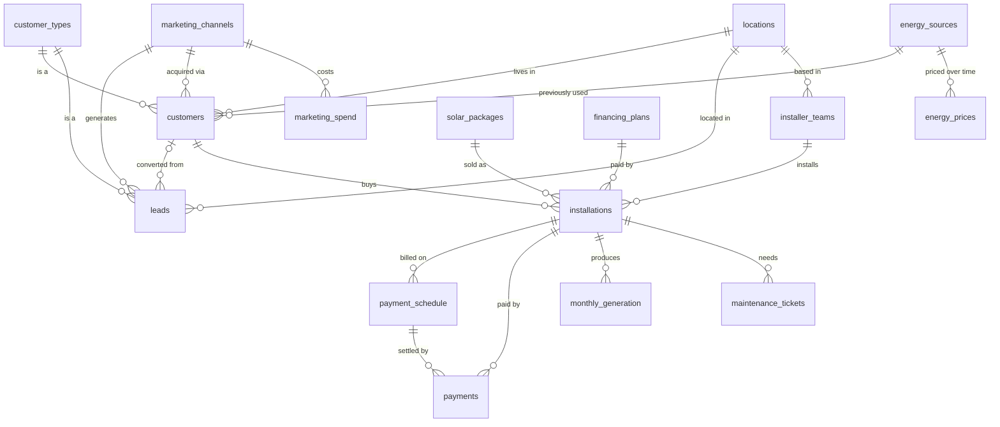

# Data dictionary: SunGrid Nigeria

**As-of date:** 31 October 2026. Leads, installations and marketing spend begin in September 2024 (launch).
**16 tables, about 134,000 rows.** Fictional company, synthetic data.

## Relationships

## Tables

| Table | Rows | Grain (one row per) | Key columns and notes |
|---|---|---|---|
| `locations` | 17 | city | `state`, `city`, `zone` |
| `customer_types` | 12 | building or business type | `segment` is Residential or Business; `type_name` is the building or business type |
| `marketing_channels` | 7 | channel | `channel_type` is Referral, Digital or Offline |
| `energy_sources` | 3 | source | `co2_kg_per_kwh` is an illustrative emission factor |
| `energy_prices` | 9 | source and effective date | `cost_per_kwh` (NGN) applies from `effective_from` until the next row for that source |
| `solar_packages` | 14 | package | `capacity_kw`, `battery_kwh`, `system_type` (Off-Grid, Hybrid, Grid-Tied), `list_price`, `unit_cost` |
| `financing_plans` | 5 | plan | `months` is the number of monthly instalments after the deposit (0 = cash); `deposit_pct`; `interest_pct` is a flat charge on the net price |
| `installer_teams` | 8 | team | `base_location_id` |
| `marketing_spend` | 182 | channel and month | `spend_month` is the first day of the month |
| `customers` | 4,534 | customer | `acquisition_channel_id`, `prev_energy_source_id` (what they used before solar), `signup_date` |
| `leads` | 14,500 | enquiry | `lead_status` is Converted, Lost or Open; `customer_id` is NULL unless converted |
| `installations` | 4,721 | installed or planned system | `status` is Completed, Scheduled or Cancelled; `install_date` is the planned date when Scheduled; a customer can have more than one installation |
| `payment_schedule` | 41,609 | instalment due | `installment_no` 0 is the deposit or cash payment |
| `payments` | 24,758 | payment received | linked to the instalment it settles through `schedule_id`; an instalment can be unpaid, part-paid or paid |
| `monthly_generation` | 42,164 | installation and month | `generation_month` is the first day of the month; a month can be missing when a meter did not report |
| `maintenance_tickets` | 1,091 | ticket | `closed_date` is NULL while the ticket is open |

## Money and units
- All money is in Nigerian naira (NGN), `DECIMAL(14,2)`.
- `total_contract_value = list_price - discount_amount + finance_charge`.
- Capacity is in kW, battery storage in kWh, energy in kWh.
